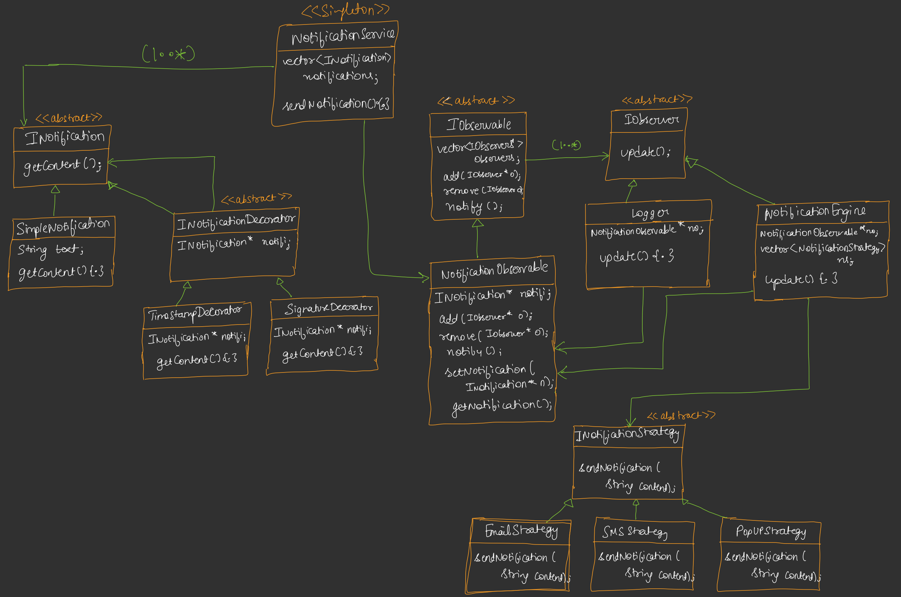
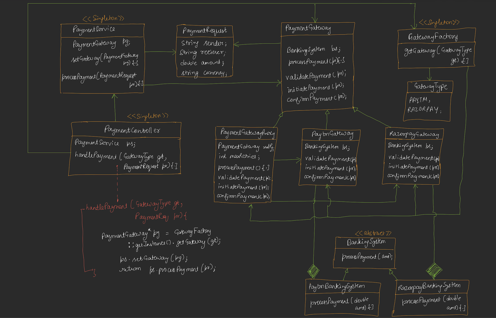

# Problems and Thier Flow

## Our Own Notification Service

### Requirements

- Plug and Play Model
- Extensible: SMS, Email, Pop-up
- Add different types of notifications dynamically
- Store all notifications / Logging

### Flow

Bottom up

Start with Notification Object
- We can have different types of Notification objects so better to create a Parent interface `INotification`
- Concrete child class for now: `SimpleNotification`
- To make adjustment to a particular notification at run time (for example: Add timestamp to a notification, Add a signature to a notification)
  - Use **`Decorator Pattern`**
  - `INotificationDecorator` interface -> TimeStampDecorator, SignatureDecorator

Now for the Observables part, Start with standard **`Observable Pattern`**
- `IObservable` interface
  - Concrete Observable: `NotificationObservable` 
- `IObserver` Observer interface
  - Concrete Observers: `Logger`
  - Now, here we can provide users a feature to start having notifications on multiple devices of their choice, like Email, SMS, Pop-up. And can be extended further like WhatsApp
  - So create a `NotificationEngine`. This Notification Engine is the concrete observer wrt to the NotificationObservable
  - Inside this NotficationEngine we can have a list of Concrete Sub Classes which would handle different type of notification sending part
    - So to send different type of Notifications, use a **`Strategy Pattern`**. An `INotificationStrategy` interface
      - `EmailStrategy`, `SMSStrategy`, `PopUpStrategy`

At the end, create a `NotificationService` to get the notification from the Notification Creators and send them to the Observers (Acts like a bridge)
- Make it **`Singleton`**

## Payment Gateway

### Requirements

- Support multiple payment gateways: Paytm, Razorpay, etc.
- Plug-and-play model to add new gateways.
- Validate, initiate, and confirm payments.
- Allow the client to select a gateway at runtime.
- Keep provider-specific banking integrations separate from payment-processing logic.
- Provide a common payment request model.

### Flow

**Hybrid approach (bottom-up leaning)**

Start with `PaymentRequest`

- A common object to represent payment details across all gateways.
- Attributes: `sender`, `receiver`, `amount`, `currency`.

Now create the external banking integration abstraction.

- Create an abstract interface `BankingSystem`.
- Concrete implementations:
  - `PaytmBankingSystem`
  - `RazorpayBankingSystem`
- These classes handle provider-specific payment processing.

Now create `PaymentGateway`

- An abstract class that defines the common payment-processing workflow.
- Attributes: `BankingSystem bs`.
- Methods: `processPayment()`, `validatePayment()`, `initiatePayment()`, `confirmPayment()`.
- Concrete subclasses:
  - `PaytmGateway`
  - `RazorpayGateway`
- Each gateway integrates with its corresponding banking-system implementation.

Now for runtime gateway selection, use the **Factory Pattern**.

- Create `GatewayType` enum: `PAYTM`, `RAZORPAY`.
- Create `GatewayFactory`.
- `getGateway(GatewayType type)` returns the appropriate concrete gateway.
- This keeps gateway selection logic out of the payment-processing code.

Now create `PaymentService`.

- Acts as the application's payment-processing service.
- Holds a reference to the selected `PaymentGateway`.
- `setGateway(PaymentGateway gateway)` configures the gateway.
- `processPayment(PaymentRequest request)` delegates processing to the selected gateway.
- A Singleton can be considered, but it is not mandatory. Avoid mutable global gateway selection if requests can execute concurrently.

Finally, create `PaymentController`.

- Acts as the entry point for payment requests.
- Receives the requested `GatewayType` and `PaymentRequest`.
- Uses the `GatewayFactory` to obtain the appropriate gateway.
- Configures the `PaymentService` and invokes payment processing.

### Overall Flow

`PaymentController` → `GatewayFactory` → `PaymentGateway` → `BankingSystem` → External payment provider.

`PaymentService` coordinates payment processing without needing to know provider-specific implementation details.

Now, to add retry functionality without modifying the actual payment gateways, use the **Proxy Pattern**.

- Create `PaymentGatewayProxy`.
- It wraps a reference to the actual `PaymentGateway`.
- The client interacts with the proxy instead of directly interacting with the concrete gateway.
- The proxy delegates payment processing to the actual gateway.
- If a retryable failure occurs, the proxy retries the operation according to the configured retry policy.
- This allows us to add retry behavior without modifying `PaytmGateway` or `RazorpayGateway`.

### Updated Flow

`PaymentController` → `GatewayFactory` → `PaymentGatewayProxy` → `PaymentGateway` → `BankingSystem` → External payment provider.